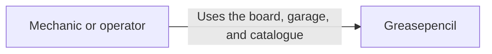
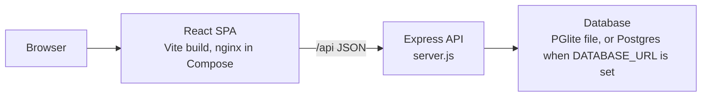
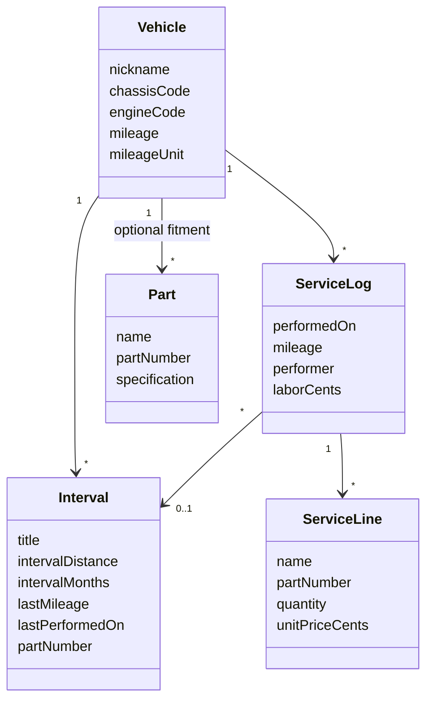

# Architecture

Greasepencil is described with the C4 model: a person, the software system, the containers that run, and the main components inside the API. A small domain model sits under that, because the status rules are easier to test when they are not buried in the page.

## Level 1 — system context

A DIY mechanic, a car enthusiast, or an independent garage operator uses a browser. The browser talks only to Greasepencil. Greasepencil does not call a dealer catalogue or the car. Part numbers and technical notes are data that person stores. One account can hold several vehicles, which is how an independent operator keeps more than one car.

## Level 2 — containers

In Docker Compose the SPA container is nginx. It serves the built React app and proxies `/api` to the API container. During local development, Vite on port 4870 does the same proxy. A single-process run (`npm start`) serves the built files from the API instead, which is how a hosted copy can run as one process. The two-container layout remains the one Compose starts.

The database is PGlite in a file (`DATA_DIR`) for local use and for the Compose volume. A published copy that sets `DATABASE_URL` uses Postgres and applies `migrations/` before serving. Preview traffic and production traffic do not share rows: the owner key includes the stage.

## Level 3 — API components

| Component | Responsibility |
| --- | --- |
| `routes.js` | HTTP resources, status codes, and the app header check |
| `auth.js` | Reads the verified viewer and builds the owner key |
| `validate.js` | Rejects a bad body before any SQL |
| `status.js` | Pure function: overdue, due now, due soon, on track, unlogged |
| `repository.js` | Parameterised SQL, including the transaction that writes a service log |
| `seed.js` | The sample W203, loaded once per viewer |

The React pages do not reimplement the due rule. They render `status` from the API and only format numbers.

## Domain model

`Part.vehicleId` is optional. Deleting a vehicle sets that link to null and leaves the catalogue row. Deleting a vehicle does remove its intervals and its service history.

## Status rule

`assessInterval` in `backend/src/domain/status.js` looks at distance and time separately, then keeps the worse result.

- No last service on a rule that is set: **unlogged**, not overdue.
- Remaining distance or days below zero: **overdue**.
- Remaining exactly zero: **due now**.
- Within 30 days, or within 10% of the distance (at least 1 000 km or 600 mi): **due soon**.
- Otherwise: **on track**.

"Today" is the calendar date in `APP_TIME_ZONE`, default `Africa/Harare`, so the board does not flip at UTC midnight for a workshop in that zone.

## Request path for recording a job

1. The service dialog in the SPA posts JSON to `/api/vehicles/:id/logs` with the header `x-greasepencil-request: 1`.
2. The route checks the viewer, then `validateServiceLog`.
3. `createServiceLog` runs in one database transaction: confirm the vehicle and the interval belong to that viewer, advance the interval if this job is the latest, raise the odometer if the reading is higher, insert the log and its lines.
4. The vehicle page reloads and renders the new status.

An older backfilled job is stored and does not move the interval backward. Deleting the log does not rewind the interval either. Both limits are stated in the interface.
